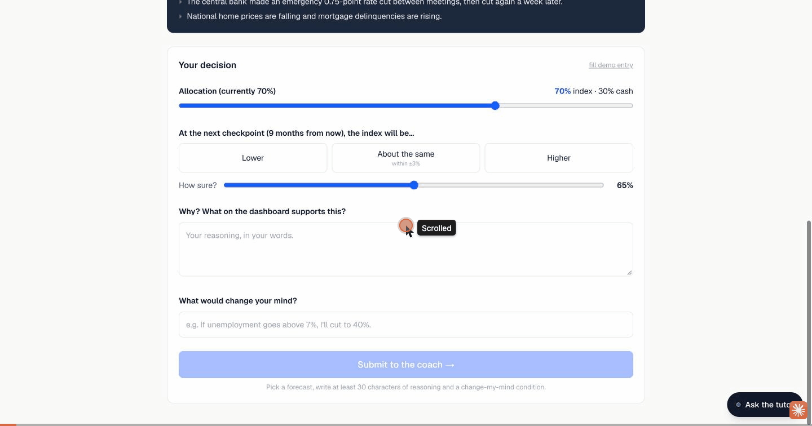

# Hindsight: an investment judgment trainer

> Most AI investing tools tell you what to buy. This one won't.

Hindsight replays real periods of market history **blind**: dates and index levels are hidden. At each checkpoint
the trainee sets an allocation, forecasts the next stretch, states their confidence, explains their reasoning
and writes what would change their mind. Only **then** does the AI coach respond, and it only asks questions.
At the end the period is revealed and the trainee is scored on **process, not outcome**.

Before practising, a **learning path** of six short lessons (allocation, drawdowns, CAPE, economic signals, the four
biases, reviewable decisions) covers everything the simulator shows. Each lesson ends with a check question. A
**tutor** is available throughout to explain concepts. It refuses to make the decision for you, to predict the
market, or (during practice) to reveal which period you're in, and it shows which guardrail rule it applied.

Run it: `npm install && npm run dev` → http://localhost:3001

## How it answers the three challenge dimensions

| Dimension | How Hindsight answers it |
|---|---|
| **01 Keep humans mentally engaged** | Nothing can be offloaded: the AI never gives an answer to copy. A think-first gate means the coach says nothing until the trainee has committed to an allocation, a forecast, a confidence level, their reasoning and a change-my-mind condition. The coach replies with questions only, and the trainee must answer or revise before locking in. The market is replayed blind, one checkpoint at a time, so there's no autopilot and no hindsight to lean on. |
| **02 Prevent skill degradation** | The AI teaches rather than answers. Six lessons cover every signal and bias in the simulator, each ending with a check question. The tutor explains concepts, then turns the question back to the trainee's own dashboard. The debrief scores the process (evidence, measurable exit triggers, calibration, bias flags) separately from the outcome, and ends with reflection questions that have no answers. |
| **03 Build trustworthy AI** | Every coach question has a "Why is the coach asking this?" panel showing the rule and the exact numbers that fired it, so the trainee can check it against the dashboard. All data is real and cited (Shiller, FRED) with links, and unemployment is shown with its publication lag so there's no look-ahead. The tutor only answers from a fixed set of written topics and says it won't guess otherwise. Its refusals name the guardrail they applied. The trainee can skip any coach question, and the debrief shows where they did. |

## How it maps to the hackathon rubric

### 1. Use case innovation

- **Problem in the theme.** New investors increasingly ask AI "should I buy X?" and hand over the judgment they
  need to build. Hindsight uses AI to strengthen that judgment instead of replacing it.
- **Novelty.** It combines three things: blind replay of real market history (no hindsight bias), a coach that only
  asks questions, and scoring on process rather than profit.
- **Target user and path to impact.** Finance students, junior analysts and new retail investors. It could plausibly
  be used in university finance courses, analyst onboarding and broker education hubs, all of which already run
  simulators that reward outcomes, not reasoning.

### 2. Technical solution design

- **Architecture.** Data pipeline → simulation → coach rules → scoring, plus a learning path and a tutor.
  `data-sources/build_scenarios.py` turns raw Shiller/FRED CSVs into `src/data/series.json`. `src/lib/trainer.ts`
  holds the simulation (allocation × index return + cash at the policy rate), the coach rules and the process
  scoring. `src/lib/lessons.ts` holds the learning path, and `src/lib/tutor.ts` holds the tutor's topics and
  guardrails (the first guardrail that matches wins). Built with Next.js + TypeScript and fully static.
- **Model usage.** The prototype uses no LLM, and this is deliberate. *Deciding* when to challenge, and which bias to
  probe, has to be auditable, so it's done by deterministic rules. An LLM is planned for only two jobs: phrasing the
  question and reacting to the trainee's free-text answer. It would be constrained to (a) ask, not advise, and
  (b) cite only the dashboard numbers it was given. The rules stay the audit trail.
- **Implementation.** A working end-to-end prototype with three real historical scenarios, six lessons and a
  complete debrief.

### 3. Responsible AI factor

- **People stay engaged and in control.** A think-first gate means the coach says nothing until the trainee has
  written an allocation, a forecast, a confidence level, their reasoning (≥ 30 chars) and what would change their
  mind. The coach replies with questions only, and the trainee must answer or revise before locking in. Skipping
  is allowed but counts against the score. The tutor refuses to make the decision for the trainee or to predict
  the market.
- **Transparency.** Every coach question has a "Why is the coach asking this?" panel that shows the rule and the
  numbers that fired it. When the tutor refuses, it names the guardrail it applied. All market data is real and
  cited (Shiller, FRED) with links. Unemployment is shown with its publication lag, so there's no look-ahead.
  Uncertainty stays visible: confidence is compared with the hit rate in a calibration gap.
- **No hallucinated claims.** The coach can only cite numbers from the dashboard. The tutor answers from a fixed set
  of written topics and says "I don't have a reliable answer to that and I won't guess" for anything else.
- **Fairness, privacy and resource use.** There are no accounts and no personal data. The only thing stored is
  lesson progress, kept in the browser's `localStorage`. Nothing is sent to a server or a model, so each session
  needs no inference compute. Lessons assume no prior finance knowledge.

### 4. Pitch authenticity and creativity

- **Narrative.** The problem is AI that tells people what to buy. The solution is AI that makes them explain why.
  The impact is a trainee who leaves with a written decision journal and an honest view of their own biases.
- **Honest about what's real.** Working today: the data pipeline, the simulation, the coach rules, scoring, lessons
  and the guardrails. Still a concept: the LLM phrasing layer, and any proof that the training improves real-world
  decisions.
- **Memorable reveal.** The trainee lives through a crash blind, then learns it was 2008, and sees that their score
  depends on how they decided, not on how much they made.

## Demo script (Scenario A, ~4 minutes)

Use the **fill demo entry** and **use demo answer** links to keep it fast.

1. **Intro.** "This AI won't tell you what to buy." Point at the three principles and the coach's rules.
   Optionally open one lesson to show the check question, then ask the tutor "Should I sell now?" during practice to show the guardrail fire.
2. **Scenario A briefing.** A real index, blind. $100k, 70% invested.
3. **Decision 1** (index −10% from peak). The trainee holds with a measurable trigger ("unemployment > 6%"). The coach asks for a **pre-mortem**.
4. **Decision 2** (−37%, a bank has failed). The recap shows the trainee's own trigger has fired. The demo trainee panic-sells to 30% with 90% confidence and a vague trigger. The coach fires a **capitulation check** and an **overconfidence check**. Open "Why is the coach asking this?" to show it's auditable.
5. **Decision 3** (−48%). The trainee holds at 30% with a measurable re-entry trigger.
6. **Decision 4** (rally). The trainee re-enters at 60%. The coach runs a **sizing check**.
7. **Reveal: the 2008 Global Financial Crisis.** The trainee lagged simply holding 70% because of the panic sale. The process score is shown separately from the outcome, along with the calibration gap (70% confident, 50% right) and reflection questions with no answers. Sources are linked.

## Scenarios

| Codename | Real period | Series |
|---|---|---|
| A (demo path) | Global Financial Crisis, 2005–2011 | S&P 500 monthly average (Shiller) |
| B | Dot-com bubble and bust, 1997–2004 | Nasdaq Composite month-end (FRED NASDAQCOM) |
| C | COVID-19 crash and recovery, 2018–2021 | S&P 500 month-end (FRED SP500) |

Macro tiles: CAPE (Shiller), unemployment (FRED UNRATE, one-month lag), effective fed funds (FRED FEDFUNDS),
10y−2y spread (FRED T10Y2Y). Returns are price-only; cash earns the fed funds rate.

"What you know right now" bullets are paraphrased events that were public by the end of each checkpoint month.
Regenerate the data with `npm run data`.

*Training simulation only, not investment advice.*
